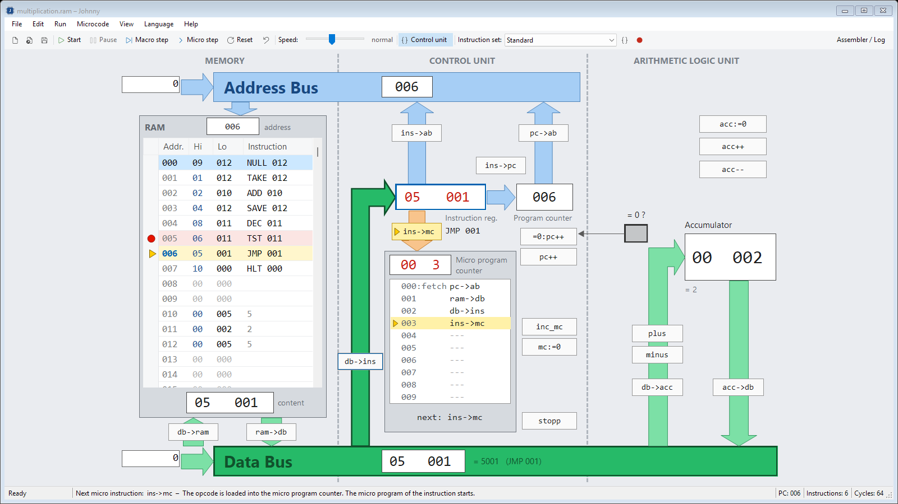
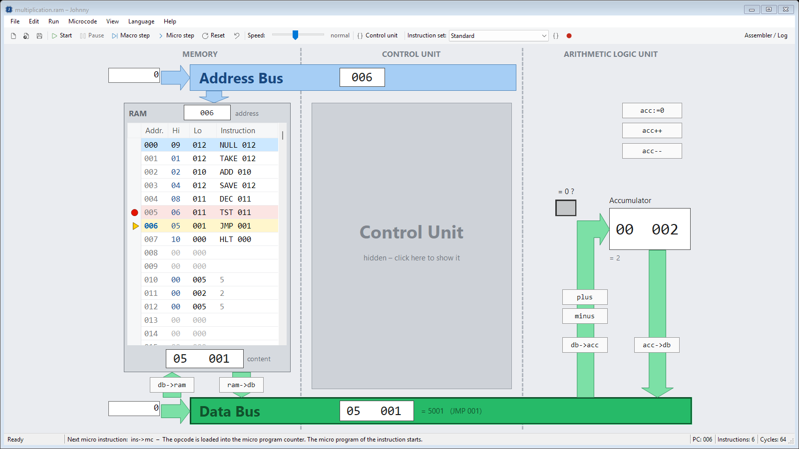
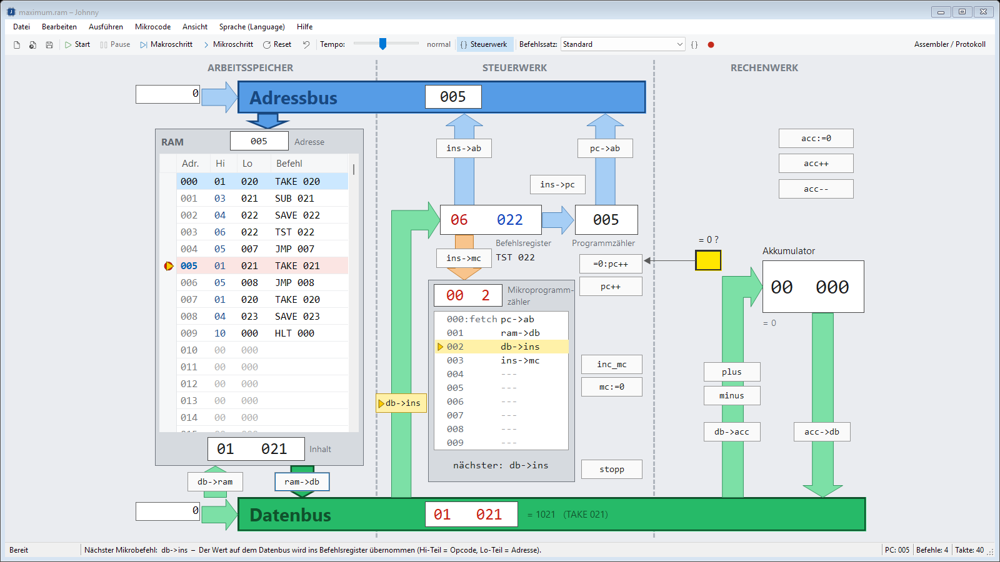
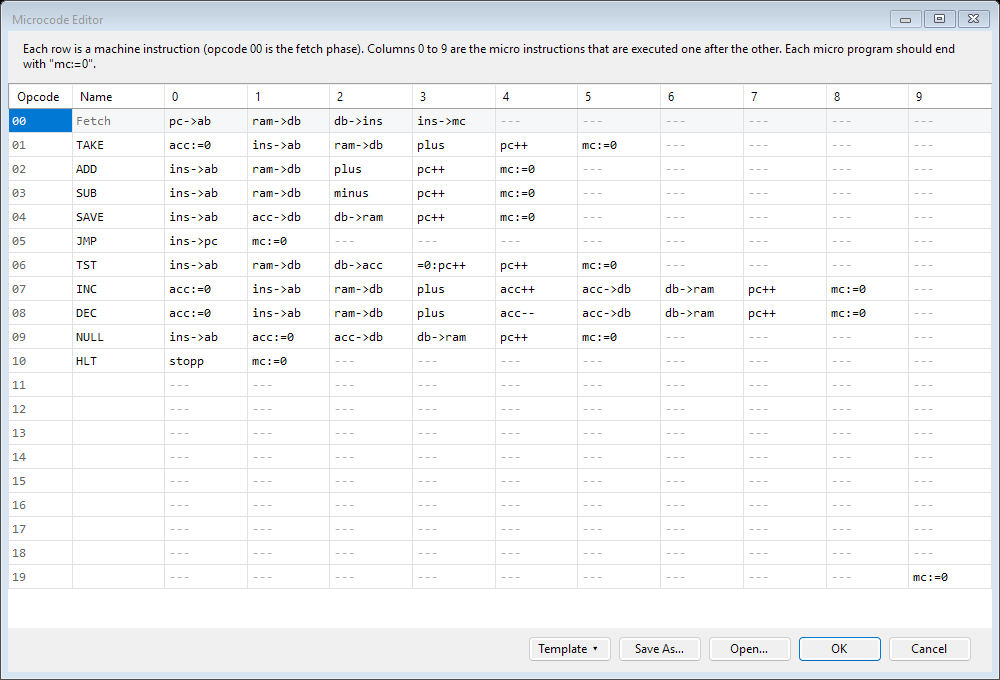

# Johnny Simulator 3.0 – improved edition 2026

A simulator of a simple von Neumann computer for computer science lessons.
A rewrite of **JOHNNY 1.01** by Peter Dauscher as a Windows application with a
reworked user interface and additional features. English and German, switchable
at any time via the **Language** menu.

*Dedicated to my cat Lulu.*

## Download and start

1. Download `Johnny.exe` from **Releases**.
2. Double-click it. No installation needed. Runs on Windows 10 and 11 (uses the
   .NET Framework 4.8 that is built into Windows), also from a USB stick.

On Linux, `Johnny.exe` should run with Mono (`mono Johnny.exe`) or Wine. This has
not been tested.

## What is new compared to the original?

- Same layout as the original: address bus at the top (blue), data bus at the
  bottom (green), memory, control unit and arithmetic logic unit with arrows for
  the data paths. The diagram fills the whole window and scales with it (good for
  projectors).
- Show or hide the control unit like in the original, input fields for the buses
- A yellow arrow marks the next micro instruction, changed values turn red
- **Undo** for every step, **breakpoints**, speed slider with turbo mode
- **Assembler**: write programs as text with comments and labels
- Insert and delete rows with automatic adjustment of addresses
- Log of all micro instructions, microcode editor, recording of new instructions
- Instruction sets Standard, Standard (old) and Bonsai, 6 example programs
- Clear error messages (e.g. a missing `HLT`)
- User interface in English and German

Micro instructions, their numbers, the microcodes and the file formats (`.ram`,
`.bma`, `.bij`, `.mpc`, `.nam`) match the original exactly. Programs can be
exchanged between both versions.

## Screenshots

**Control unit hidden** – like in the original, students then operate the
computer by hand with the micro instruction buttons:

**German user interface** (menu *Language*), running the maximum example:

**Microcode editor** – the micro programs of all instructions as a table:

## Building it yourself

Run `bauen.bat` in the `Quellcode` folder. It uses the C# compiler that comes
with every Windows installation with .NET Framework 4 and puts `Johnny.exe` into
the main folder. No other software is needed.

## License and authors

- Original: **JOHNNY 1.01**, © 2009–2014 Peter Dauscher, Gymnasium am Kaiserdom,
  Speyer, published under the GNU General Public License version 3.
  [sourceforge.net/projects/johnnysimulator](https://sourceforge.net/projects/johnnysimulator/) ·
  source mirror: [github.com/philip1337/johnny-simulator](https://github.com/philip1337/johnny-simulator)
- This edition was rewritten in C# in 2026 with the help of Claude (Anthropic).
- License: **GNU GPL version 3**, see [LICENSE](LICENSE).
  The program may be used, shared and modified. Copies and modified versions must
  again be licensed under the GPLv3, together with the source code and the
  copyright notices. There is no warranty.
- The photo of Lulu in the splash screen is part of the project and is distributed
  with it under the same terms.
